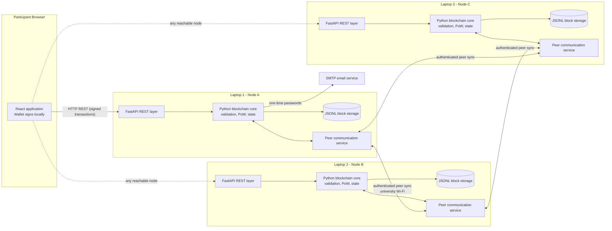

# Architecture Overview

This document describes the agreed architecture of the E-Waste Management Blockchain academic project. It reflects `docs/PROJECT_SPECIFICATION.md`, which remains the authoritative reference.

## 1. Purpose

The system records the custody, transfer, processing and transformation of electronic waste and recovered materials. Participants interact through a web interface. Their actions become signed transactions that are validated and recorded by a small, independent network of blockchain nodes.

This is a controlled academic demonstration. It is not a production, regulatory-compliance or certified waste-management system.

## 2. Network topology

- Three independent nodes, each running on one team member's laptop.
- Each laptop runs one Python blockchain node, one FastAPI process, its own JSONL blockchain storage, its own node identity and credentials, and a peer communication service.
- The React production build is served by each node's FastAPI process.
- There is no central shared server. Each node independently validates data and maintains its own copy of the chain.
- All nodes communicate over university Wi-Fi using a manually configured peer list.
- Participants can open the application through the address of any reachable node.

## 3. Components and responsibilities

| Component | Responsibility |
| --- | --- |
| React frontend | Presents the participant interface. Manages wallet interaction in the browser. Submits signed transactions. Is not a trust boundary. |
| FastAPI layer | Provides the REST API for participants, node operators and peers. Validates all incoming input. Serves the React build. |
| Python blockchain core | Validates blocks and transactions, enforces business and permission rules, calculates balances, performs Proof of Work, selects the canonical chain, and handles forks. |
| Local JSONL storage | Stores accepted blocks append-only on each node. A small metadata file identifies the canonical tip. |
| Peer communication service | Authenticates peers, checks network compatibility, exchanges chain information, and synchronizes missing blocks. |
| Email (SMTP) | Delivers one-time passwords for email verification. Contact details and OTPs are never placed on-chain. |

## 4. Cryptography

- SHA-256 is used for block hashes, transaction IDs and integrity checks.
- Blocks are hashed over a deterministic canonical serialization of the header, never over arbitrary JSON text.
- ECDSA secp256k1 is used for participant signatures.
- Wallet private keys are encrypted with a key derived from the wallet password using Argon2id or scrypt, and protected with authenticated encryption such as AES-GCM.
- Private keys never leave the participant's wallet and are never sent to nodes or peers.
- Node-to-node communication uses mutual TLS with certificate fingerprint pinning. Each node has its own identity key and TLS certificate (section 16).

## 5. Wallets and signing

- Each participant has a wallet consisting of a key pair, a blockchain address and an encrypted private-key file.
- The wallet is unlocked with the wallet password and locks automatically after 15 minutes of inactivity.
- Signing happens locally. Only the signed transaction is submitted to a node.
- Nodes verify signatures with the public key.
- Wallets can be backed up, exported and restored. A restored wallet reproduces the same identity.
- Wallet portability between node addresses is limited by browser origin scoping; see section 17.
- A participant can suspend their own wallet. The suspension is recorded on-chain and a suspended wallet cannot initiate new business transactions.

## 6. Blockchain and consensus

- Each block contains its height, previous block hash, timestamp, ordered transactions, nonce, block hash and a network reference.
- Consensus uses fixed-difficulty SHA-256 Proof of Work with a target block time of about 10 to 15 seconds.
- There is no mining reward, no cryptocurrency and no transaction fee. Mining only produces and validates blocks.
- Any node operator may start or stop mining.
- The canonical chain is the valid chain with the greatest cumulative Proof of Work. Equal-work ties are broken by selecting the lexicographically smaller tip hash.
- An invalid chain is never adopted.
- When a reorganization occurs, the node rebuilds its state from the winning chain. Transactions from the removed branch are re-evaluated and may return to pending or be rejected.
- Timestamps are UTC ISO 8601. A block timestamp must exceed the median of the preceding 11 blocks and is constrained relative to the previous block.
- Three-node Proof of Work is not production-grade Byzantine-fault-tolerant consensus. This limitation is documented in the specification.

## 7. Network genesis and identity

- All nodes share one identical, versioned network configuration, containing the network ID, protocol version (initially `1`), genesis parameters and hash, initial difficulty, agreed limits, trusted node IDs and trusted certificate fingerprints (section 16).
- The genesis block is generated deterministically from the shared configuration and distributed identically to all three laptops.
- A node checks network ID, protocol compatibility and genesis hash before joining and refuses to join if any check fails.

## 8. Peer authentication and synchronization

- Each node knows the addresses of its two peers and authenticates them.
- Nodes check network ID and protocol version and reject unknown or incompatible peers.
- Peers exchange chain information (latest block, cumulative work) and download missing blocks.
- Incoming blocks and transactions are validated independently before acceptance.
- If a peer is offline, the node continues operating locally and retries synchronization when connectivity returns.

## 9. Transaction lifecycle

- Every transaction has a unique ID derived from its canonical content, and its signed content covers every field affecting its meaning.
- Transactions are ordered by timestamp and then by ID. Conflicting transactions are resolved by the first valid one in that order.
- Each node keeps a local pending pool. Pool contents are validated independently and reconciled whenever the canonical state changes.
- States are `PENDING`, `CONFIRMED`, `REJECTED` and `CANCELLED`. A transaction is confirmed only when included in the currently accepted valid chain.

## 10. Participant roles

Each wallet registers for exactly one of five roles, which cannot be changed afterwards:

1. Generator
2. Collector
3. Transporter
4. Recycler
5. Material Processor

Registration requires an email OTP, after which a verification attestation signed by one of the trusted nodes is recorded on-chain.

## 11. E-waste custody and processing workflow

Permitted custody transfers:

- Generator to Collector
- Collector to Transporter
- Transporter to Recycler
- Recycler to Material Processor
- Material Processor: no further transfer in the initial version

Workflow:

1. Only a registered Generator creates an original e-waste batch, recording its description, quantity and signature.
2. A sender requests a full or partial transfer. The declared quantity is reserved when the request is confirmed on-chain.
3. The receiver accepts, recording the actual received quantity, or rejects with a reason. Both sender and receiver sign.
4. Any shortfall is recorded as a discrepancy with a mandatory reason. Cancellation, rejection or expiry releases the reservation without changing ownership. Transfers expire after 48 hours using consensus timestamps.
5. Recycler and Material Processor record processing operations. Each operation satisfies input quantity equal to the sum of outputs plus residual waste. Each recovered material receives a unique ID and provenance links.
6. Partial processing is permitted, and unprocessed quantity remains in inventory.
7. Corrections are new signed transactions referencing the original record.
8. Balances, completion states and traceability are derived from accepted blockchain records.

## 12. Participant and node-operator separation

Participant functionality:

- Wallet, registration, dashboard, batches, transfers, materials, processing, history and notifications.
- Only the actions permitted for the participant's role are shown.
- Participants see traceability only for batches and materials in which they have been involved.

Node-operator functionality:

- Start and stop the node, start and stop mining, view technical logs, manage peer settings, and export or import validated backups.
- Each operator has a separate operator password and authenticated, time-limited sessions.
- Node-management functions are accepted only from the node's own computer (loopback addresses), never from the network.
- Operator access never permits editing confirmed records or bypassing validation.

Node-operator functions are not available to ordinary participants.

## 13. Persistence and recovery

- Each node stores accepted blocks in append-only JSONL files. No conventional database is used initially.
- Competing branches can be retained during fork resolution without rewriting historical records.
- A single writer is enforced with file locking. Canonical-tip metadata is replaced atomically.
- On startup, stored records are validated. Malformed records or invalid blocks stop normal operation rather than being skipped.
- Backup imports are written to a temporary location, validated fully, compared with the active chain and adopted only after validation.

## 14. Architecture diagram

## 15. Limitations

The architecture is intentionally limited to a controlled academic demonstration. The limitations in section 24 of the specification apply, including: email verification does not prove real-world identity; a person may hold multiple wallets; three-node Proof of Work is not Byzantine-fault-tolerant; a compromised node can disrupt the network; university network policy affects connectivity; the system does not certify legal or environmental compliance; and node operators can see replicated blockchain data.

## 16. Node identity and configuration

Each node has its own node ID, identity private key, TLS certificate, certificate SHA-256 fingerprint and local configuration. Node identity is separate from participant wallets (specification C2 and C3).

Peer authentication uses mutual TLS with certificate fingerprint pinning. A peer is accepted only when both sides authenticate and the presented fingerprint matches the trusted fingerprint for that node ID in the shared network configuration.

Manual provisioning:

1. Each operator generates their node identity key and certificate on their own laptop.
2. The private identity key stays on that laptop.
3. Public certificates are exchanged among the three operators through an agreed secure channel.
4. The three operators calculate and verify each certificate's SHA-256 fingerprint.
5. Trusted node IDs and fingerprints are added to the shared network configuration.
6. The identical configuration is distributed to all three laptops.
7. Mutual authentication is verified before any peer communication is accepted.

Renewal: a replacement certificate is verified with the same procedure and requires an agreed update to the shared configuration, applied identically on all three nodes. A new certificate is never trusted merely because it presents the same node ID. The activation procedure for renewals is still to be agreed (specification C9).

Shared versus per-node configuration:

| Setting | Scope |
| --- | --- |
| Network ID, protocol version, genesis parameters and hash | Identical on all nodes |
| Consensus parameters, difficulty and limits | Identical on all nodes |
| Trusted node IDs and certificate fingerprints | Identical on all nodes |
| Node ID, identity key and certificate | Unique per node; private key never shared |
| Listening host and port | Unique per node |
| Local data directory | Unique per node |
| Peer addresses and ports | Per node; each lists the other two |
| Operator password and SMTP settings | Per node; secret, never shared |

Shared configuration is versioned. Once the network has started, consensus-critical settings are not silently changed. A change that alters network identity or genesis compatibility requires a deliberately new network. No secret is placed in the shared configuration or in any repository.

## 17. Browser origin and wallet portability

Browser-local storage such as IndexedDB is scoped to an origin. An origin includes the address and port, so different node addresses are different origins. A wallet stored through one node address is therefore not guaranteed to be available through another.

Participants must still be able to use any reachable node (specification 3.4). The mitigation is encrypted wallet export and import:

- Export produces an encrypted wallet file.
- Import requires the wallet password.
- A restored wallet reproduces the same public key and wallet address.
- The plaintext private key is never sent to a node.
- No central wallet server or shared private-key storage is introduced.

Participant-facing text must explain that a wallet is kept in the browser used with a given address and must be exported to be used elsewhere.

## 18. Frontend delivery trust

The React application is served by a node. A malicious or compromised node operator could serve modified JavaScript that captures wallet passwords or decrypted key material.

Browser-side key generation and signing keep private keys away from the nodes, so an honest node never needs custody of them. These measures do not protect against malicious frontend code. For the initial demonstration, the three designated operators and the builds they serve are treated as trusted. No browser extensions, separate wallet applications or extra infrastructure are added, and any stronger protection must be discussed first.

## 19. Deployment and development environments

- The Linux environment used for code generation and development is not the deployment target.
- The deployment target remains Windows 11 on all three laptops.
- Code and dependencies must be portable Python and React, selected for the actual Windows laptops.
- Deployment validation must occur on all three Windows laptops. Results in the development environment do not count as deployment validation.

